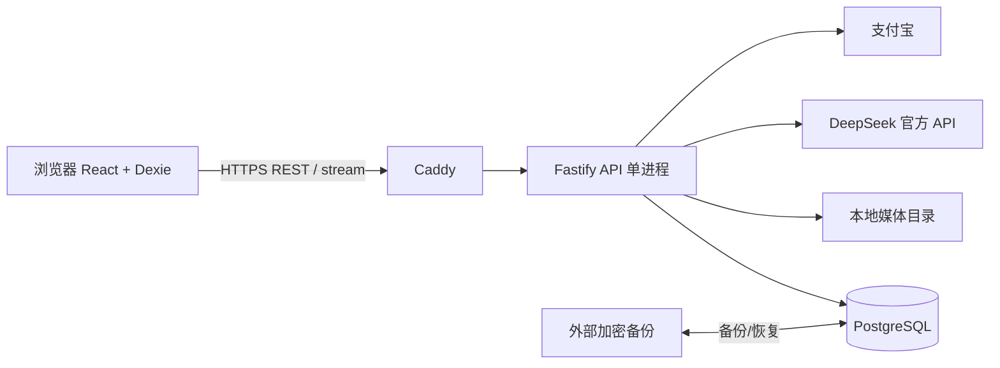

# ARCHITECTURE — 模块化单体与依赖边界

## 系统上下文



Web 由 Vite 构建静态文件，Caddy 服务静态资源并反代 `/api`。生产只运行 API、PostgreSQL、Caddy。构建在台式机或 GitHub Actions；服务器不跑 `vite build`、不跑模型。

## Monorepo 目标结构

```text
apps/web                React/Vite + Tailwind/shadcn + Dexie
apps/api                Fastify 路由/身份认证/事务/模型代理
packages/domain         纯领域实体与不可变 ID/版本 Schema
packages/tavern-core    角色、世界书、宏、预设、分支算法
packages/prompt-engine  确定性 PromptCompiler + provenance + budget
packages/compat         V2/V3/JSONL/DeepSeek ZIP 导入导出及测试样本
packages/sync           变更协议/本地 outbox/冲突策略
packages/billing        Money/Points/Order/Wallet/Settlement 领域规则
packages/provider       DeepSeek 适配及能力/价格快照抽象
packages/contracts      HTTP + 事件 + Zod/OpenAPI 契约
infra                   Compose, Caddy, deploy, backup/restore
scripts                 migration, seed, smoke, reconcile
```

## 依赖层次

- `domain` 无框架、无数据库；`tavern-core` 与 `prompt-engine` 只依赖纯领域与可注入服务（时钟、随机、tokenizer）。
- `compat` 与 `sync` 不反向依赖 UI；`billing` 不依赖聊天正文。
- API 通过 Ports/Adapters 连接 Postgres、DeepSeek、支付宝；React 只使用公开 contracts。
- 允许客户端预览 Prompt，但**服务端使用权威实体版本重新编译并校验请求**；不可相信客户端上传的最终 prompt、费用、积分或审核级别。

## 一次正常生成的时序

1. 客户端将编辑草稿提交并获得所有相关 `entityRevision`、`branchRevision` 确认。
2. `POST /generations` 传 conversation/head、预期版本、client_request_id、模型与 maxPoints；不传 API Key，不传可信价格。
3. 服务端短事务验证所有权/版本/额度；固定上下文快照（设定版本 ID/摘要）；冻结积分；创建 `generation_run=reserved`，提交事务。
4. 服务端加载最终 Prompt（确定性编译）、调用 DeepSeek，开始 SSE 传 `run.started` 与 token 等事件。
5. 回复先作为临时输出；只在终态成功且内容安全通过后，事务性创建正式消息、推进分支指针、完成积分结算。
6. 向其他设备发布同步游标更新（首版可由增量拉取实现）；客户端收到权威版本并清空本地临时缓冲。
7. 异常进入可恢复终态，不允许未结算冻结无限悬挂；由对账任务处理未决运行。

## 同步与流媒体隔离

- `GET /sync?cursor=` 返回变化日志与下一个游标；`POST /mutations` 批量应用带 idempotency key 的本地操作。无 CRDT，无双用户共编。
- `POST /generations` 可能返回 SSE；`GET /generations/:id` 支持断连后查询状态。**断连不自动重新发起模型调用。**
- 服务器必须具备速率限制、请求体上限、背压与单用户并发生成约束，避免 3 Mbps 出网上传长 Prompt 互相挤占。

## 部署与资源

- `api` 单进程，受控数据库连接池（如 4–8，按压力测试调整）；数据库同机仅内网连接；Caddy 80/443，Postgres 5432 不暴露公网。
- 资源初始上限示意：Caddy 64–128MB、API 256–512MB、Postgres 384–640MB、系统与 page cache 余量；是设计预算，非测试结果。
- 每次生成设置上游超时、用户并发上限、每用户日额度、全站余额安全阈值；优先降级附加功能而非无限堆请求。
- 不能只以“进程没 OOM”作为完成；应测量 p95 首屏/数据库查询/同步延迟、实际带宽及内存峰值。

## 模块交付规则

每模块至少具备：Schema、Ports、单元测试、集成测试、故障注入、可观测事件、迁移方案和文档。跨模块状态变更必须明确所有者，不允许在路由层拼业务规则。
